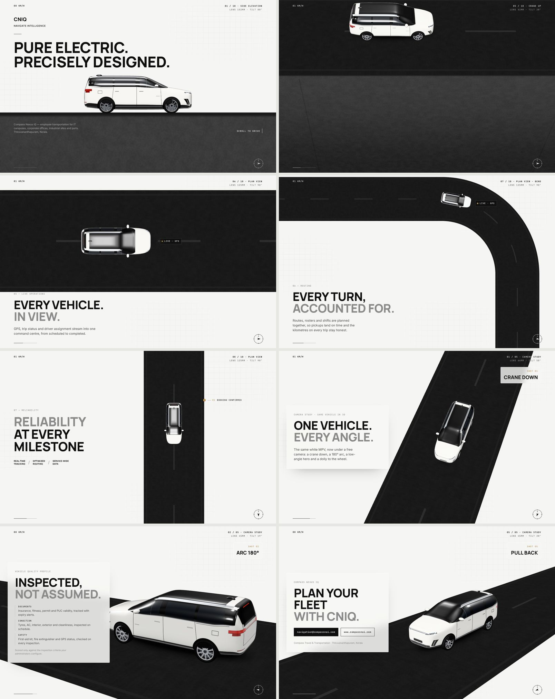

# CNIQ · Scroll Drive — 3D camera demo

A GSAP + Three.js scroll experience for **Compass Nexus iQ (CNIQ)**. One white premium MPV drives a long dark mat road through:

- **Scenes 01–07 · side elevation.** The mat rises under the car, ghost type passes behind it, and the copy sits on the road. Two premium glass card rails slide across the mat while the car keeps driving: six services, then eight Compass Nexus iQ platform modules (compassnai.com), each with a scrubbed progress meter and a counter. Scene 07 draws a gold workflow line (request → account → trip → assign → live → verify → invoice → insight) and lights each node as the line reaches it.
- **Scenes 08–14 · plan view.** A crane-up turns the elevation into a top shot. The car takes a bend, then runs a long vertical road where eight trip milestones (booking → payment) light up as it passes. Scene 13 steps a trip-status list from Scheduled to Billed while the car drives.
- **Camera study · 3D.** The same vehicle under a free camera: crane down, a 180° arc, a low-angle hero, a dolly-in to the wheel, and a pull-back.

Every scene uses one procedural vehicle model, so side, top and 3D views stay consistent.



## Run it

It is a static page, so any local server works:

```bash
cd demos/cniq-mpv-scroll && python3 -m http.server 8080
```

Then open <http://localhost:8080>. Opening the file directly with `file://` will not work because ES modules need an HTTP origin.

Libraries load from jsDelivr with pinned versions and SRI hashes: `three@0.170.0`, `gsap@3.12.5` and ScrollTrigger. Fonts come from Google Fonts (Manrope, Inter, JetBrains Mono).

URL flags:

| Flag | Effect |
|------|--------|
| `?noscrub` | Scroll maps 1:1 to the timeline with no smoothing (useful for screenshots and QA) |

For automated checks, `window.__cniq.seek(t)` scrolls to timeline second `t` (0–23.75). The scroll track is 33 viewports tall (about 1.4 viewports per timeline second).

## Files

| File | Role |
|------|------|
| `index.html` | Scene copy (all real DOM text), HUD, milestones, study panels |
| `styles.css` | Tokens, layers (paper → ghost type → WebGL → copy → HUD), portrait layout |
| `main.js` | Route, road and mat shaders, camera rig, composition solver, GSAP master timeline |
| `vehicle.js` | Procedural MPV: lofted body, per-fragment trim shader, wheels, mirrors |
| `decisions.md` · `storyboard.md` · `compiled-spec.md` | cinematic-ui workflow artifacts for this demo |

## GSAP effects

Everything is one scrubbed master timeline, so every effect plays forward and backward with the scroll:

- **Word-mask titles:** at boot every `.title` is split into masked words, which rise in with a slight rotation and leave upward.
- **Card rails:** cards rise in one by one with a 3D tilt, their icons draw themselves (`pathLength=1` + `stroke-dashoffset`), tag chips slide in, and the meter's counter ticks up.
- **3D card wall:** every frame, each rail card is turned (rotateY) and pushed back in depth (translateZ) by its distance from the screen centre, so the rail bends like a curved wall. A specular sheen sweeps across the glass and the edge cards darken. Cards also lift and flip in on entry (expo ease). The airport/intercity cards hinge in on a 3D door swing, and study panels tilt in.
- **Steppers:** the workflow nodes and the trip-status list are lit by a proxy tween whose `onUpdate` toggles classes.
- **Smaller staggers:** the sectors line, reliability features, role chips, the verified chain, the inspection checks, and the CTA buttons.
- **Colour type on the white sections:** the second line of each title on paper is a blue → gold gradient that sweeps through as the words rise, and eyebrows track in from wide letter-spacing. The hero title has its own load intro and a slow gold shimmer.
- **3D cards, premium pass:** card content floats at different depths (preserve-3d), the centre card follows the pointer with a gold rim light, and cards bob gently.
- **Colour editions:** a picker switches the same vehicle between Pearl White, Cosmos Black, Graphite Grey, Harbour Blue and Champagne Gold (paint and studio reflection tween together). The choice is remembered per viewer; `?edition=cosmos` sets it from the URL.
- `prefers-reduced-motion` skips the word split and keeps the plain fades.

## How the camera works

GSAP never moves the camera directly. It tweens a small `rig` object, and `main.js` turns that rig into a camera every frame:

- `elev` / `azim`: a spherical position around the subject (0° = side elevation, 90° = plan).
- `fov` + `vw` (metres visible at the subject): the distance is derived from both, so a lens change becomes a dolly zoom with the subject held at constant size.
- `sx` / `sy`: a **lens shift** written into the projection matrix places an anchor point (the road edge in elevation, the car in plan) at an exact screen position. This makes the mat rise without tilting the camera.
- `follow`: blends between tracking the car and holding a fixed frame (the bend scene).
- `wheel`: retargets the camera to the front wheel for the dolly-in.

DOM positions such as the road top, road edges, milestones, the live tag and the compass needle are projected from 3D each frame, so the copy stays attached to the road.

## The vehicle

`vehicle.js` builds a white MPV/wagon from lofted superellipse sections. The side profile, axle positions, beltline, door shut-lines, lamp placement and spoiler are measured from the user's side-view reference photo and scaled to 4.72 m (short sloping bonnet, long raked windscreen, roof spoiler over a raked tailgate, hinged rear doors). All paint, glass and trim zones are resolved per fragment in object space, so edges stay crisp at any zoom without textures. The premium trim includes:

- Pearl-white paint with a deep clearcoat and a faint thin-film flop, applied to painted surfaces only.
- Matrix projector lamps, an L-shaped DRL signature, and a full-width LED light blade front and rear.
- Satin-metal accents: window surround, roof rails and frame, sill blade, door garnish, front bar, lower lip, intake blades and a finned diffuser.
- A white roof with a large see-through panoramic glass panel (slim satin frame, satin rails): from above you can see the cabin floor and three seat rows through a light tint, and lighter grey-tinted side glass and windscreen instead of near-black.
- Piano-black pillars, a privacy-tinted rear cabin, panes with a sky gradient, and a dark panoramic roof.
- Flush handles with shut-lines, a charge-port flap, parking-sensor dots, and hood character lines.
- 10-twin-spoke two-tone rims with a polished lip on low-profile tyres (tread and sidewall texture), large discs and graphite calipers.

Badges and plates are intentionally blank. The model is an unbranded interpretation of the reference vehicle; it does not reproduce any manufacturer's logos or trademarks.

## Accessibility and fallbacks

- All copy is real HTML. The scroll story fades sections in and out, and the order is linear.
- `prefers-reduced-motion` turns off scrub smoothing and decorative loops.
- If WebGL is unavailable, the page shows a static dark road band under the copy.
